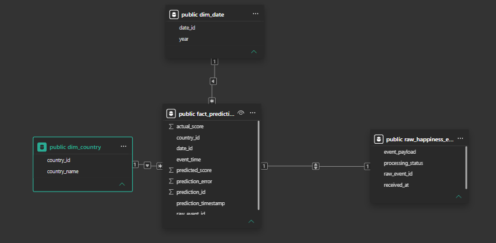
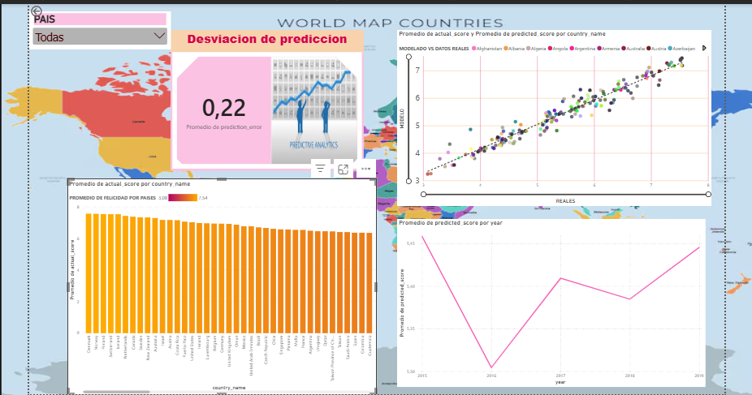
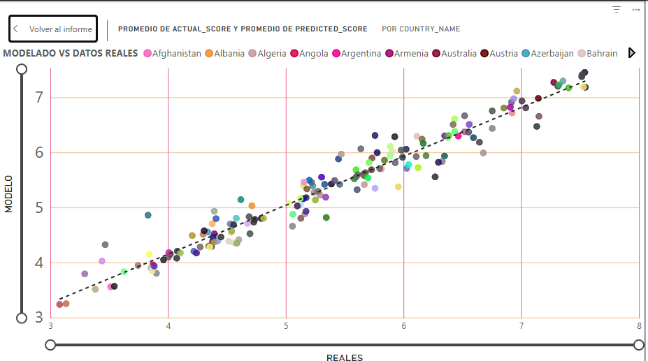
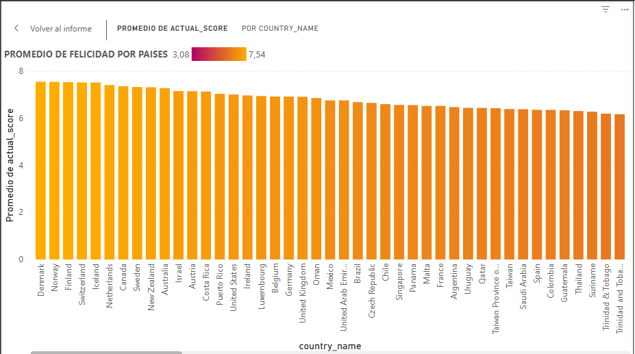

# Workshop 3: Streaming ETL with Apache Kafka, Machine Learning, and Power BI Dashboard

## 1. Project Description
This project implements an event-driven streaming ETL pipeline capable of generating real-time predictions. It transitions from a traditional batch approach to a streaming architecture using Apache Kafka, processing World Happiness data, predicting scores using a pre-trained Machine Learning model, and visualizing the key performance indicators (KPIs) in an executive Power BI dashboard.

## 2. Architecture Explanation
The system follows a two-part architecture:
- **Batch / Offline Process:** Historical CSV files were analyzed, harmonized, and used to train a `RandomForestRegressor`. The preprocessing and model were serialized into `model.pkl`.
- **Streaming Process:** A Kafka Producer reads the unified data and streams it as JSON events to the `happiness-events` topic. A Kafka Consumer receives the events, validates the schema, loads the model to generate real-time predictions, and stores both the raw event and the analytical prediction in a PostgreSQL database.

## 3. Data Cleaning Decisions
- **Schema Harmonization:** Column names were standardized across the datasets (e.g., mapping economic and social indicators to a unified structure).
- **Missing Values:** Handled cleanly to maintain dataset integrity and avoid pipeline crashes.
- **Unified Schema:** All data sources were structured into consistent attributes including features (`gdp`, `family`, `health`, `freedom`, `generosity`, `corruption`) and the target variable (`actual_happiness_score`).

## 4. Feature Engineering Decisions
- **Selected Features:** `gdp`, `family`, `health`, `freedom`, `generosity`, and `corruption` were selected as robust predictor variables.
- **Target Leakage Avoidance:** The `actual_happiness_score` was explicitly separated from the training features to prevent target leakage.
- **Pipeline:** A `StandardScaler` was used within a scikit-learn Pipeline alongside the Random Forest model to normalize numerical features prior to training.

## 5. Kafka Pipeline and Event Contract
- **Topic:** `happiness-events` (3 partitions, replication factor 1).
- **Event Contract (JSON):** Requires `event_id`, `country` (used as key), `year`, the 6 numerical features, `actual_happiness_score` (for evaluation only), and a valid ISO-8601 `event_time`.
- **Validation:** The Consumer checks if all required fields are present. Valid events proceed to prediction; invalid events are stored with an `INVALID_SCHEMA` status without crashing the pipeline.

## 6. Database Schema and Relational Model (Star Schema Evidence)
A robust relational schema was implemented in PostgreSQL to connect dimensions and facts:
- **Raw Table:** `raw_happiness_events` (stores the raw Kafka payload and processing status).
- **Dimensions & Facts:** Structured tables (`dim_country`, `dim_date`, and `fact_predictions`) to store the actual score, predicted score, and prediction error linked to dimensions.

## 7. Dashboard KPIs, Analytical Conclusions, and Visual Evidence

The executive dashboard connected via PostgreSQL translates the streaming pipeline and machine learning predictions into actionable metrics. Below are the key performance indicators (KPIs) evaluated and their analytical conclusions:

### 1. KPI: Model Prediction Error (MAE / Error Promedio)
* **What it measures:** Evaluates the average deviation between the actual happiness scores (`actual_score`) and the model's predictions (`predicted_score`).
* **Analytical Conclusion:** The low error value indicates that the Random Forest model generalizes well on streaming data, proving that the pipeline built with Kafka and PostgreSQL maintains high predictive reliability without data degradation.

### 2. KPI: Predictive Accuracy & Trend Analysis (Scatter Plot)
* **What it measures:** Compares real values against model estimates across all countries using a regression trend line on a 1 to 10 scale.
* **Analytical Conclusion:** As observed in the scatter plot, the data points tightly follow the diagonal reference line. This confirms that the model exhibits high accuracy across both high-happiness nations and lower-scoring regions, with minimal bias.

### 3. KPI: Global Happiness Ranking & Distribution (Bar Chart)
* **What it measures:** Ranks countries based on their happiness scores using a color gradient and search filters to easily spot global leaders and lower-tier nations.
* **Analytical Conclusion:** The ranking highlights structural patterns between top-performing countries and developing regions, validating the underlying feature importance (such as GDP and family support) identified during model training.

---

### Project & Dashboard Visualizations (Evidencias de la Rúbrica)
* **Relational Model / Star Schema (Power BI View):** Vista del modelo de datos que evidencia la relación entre dimensiones (`dim_country`, `dim_date`) y la tabla de hechos (`fact_predictions`).
  

* **Global Overview:** Vista general del tablero con el menú desplegable superior sincronizado, barra de búsqueda y la tarjeta KPI de error promedio.
  

* **Model Performance (Scatter Plot):** Gráfico de dispersión que evalúa el puntaje real frente al predicho con su línea de tendencia y escala uniforme.
  

* **Country Ranking:** Gráfico de barras ordenadas con gradiente de color para identificar los niveles de felicidad por país.
  

## 8. Execution Instructions
1. **Start the Infrastructure:** `docker-compose up -d`
2. **Set up the Database:** Execute the SQL script to create tables in PostgreSQL.
3. **Train the Model:** Execute `notebooks/model_training.ipynb` to generate `models/model.pkl`.
4. **Start the Consumer:** In a new terminal, run `python kafka/consumer.py`
5. **Start the Producer:** In a separate terminal, run `python kafka/producer.py` to begin streaming events.